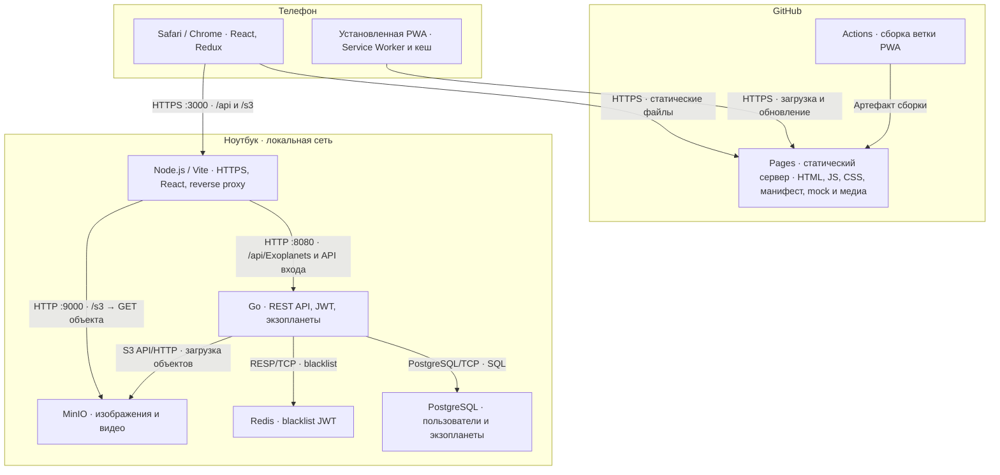

# Лабораторная 7 · Exoplanets

## Запуск и публикация

Исходники находятся в ветке `PWA` репозитория `Exoplanets_frontend`. Файлы из архива можно скопировать поверх рабочей копии той же ветки, начиная с корня репозитория. Нужны изменения и из `.github`, и из `my-app`.

```zsh
cd ~/Exoplanets_frontend
git switch PWA
cd my-app
npm ci
npm run build:pages
npm run preview -- --mode pages
```

Проверь `http://localhost:4173/Exoplanets_frontend/`. Публичная сборка выбирает mock до HTTP-запроса. Плитка и лента работают с хеш-маршрутами, например `#/grid`. При переходе с плитки по «Подробнее» и обратно по иконке плитки значение поиска и категория остаются в Redux.

Для публикации выбери в GitHub **Settings → Pages → Source → GitHub Actions**. Workflow `.github/workflows/pages.yml` выполняет сборку на push в `PWA`. Если первый запуск произошёл до переключения Source, открой **Actions** и повтори запуск. Ожидаемый адрес — `https://a-feel-u.github.io/Exoplanets_frontend/`. Ветка для исходников и запуска workflow — `PWA`. Деплой через ветку `gh-pages` не нужен.

PWA использует `public/manifest.webmanifest` и service worker из `scripts/pages-worker.js`. Сборка создаёт `dist/sw.js` со списком версионируемых статических файлов. После первого посещения без сети доступны интерфейс, mock и постеры. Видео MP4 загружаются по сети.

## HTTPS в локальной сети

1. Подключи телефон и Mac к одной сети Wi-Fi. В настройках сети Mac посмотри IPv4. Подставь его вместо примера `192.168.1.23`.
2. В `my-app` выпусти сертификат для этого адреса:

```zsh
brew install mkcert
mkcert -install
mkdir -p .certs
mkcert -key-file .certs/lan-key.pem -cert-file .certs/lan-cert.pem localhost 127.0.0.1 192.168.1.23
```

3. Перенеси на телефон только публичный `rootCA.pem` из каталога `mkcert -CAROOT` и установи его как доверенный CA. На iPhone после установки профиля включи полное доверие в **Настройки → Основные → Об этом устройстве → Доверие сертификатам**. На Android пункт установки CA находится в настройках безопасности. Закрытые ключи и каталог `.certs` остаются на Mac.
4. Запусти PostgreSQL, Redis, MinIO и Go, как в предыдущей работе. Если Vite уже запущен на порту 3000, останови его. В `my-app` выполни `npm run dev:lan` и открой на телефоне `https://192.168.1.23:3000/` со своим IP.
5. Войди учебной учётной записью. Проверь плитку и ленту с данными Go, а затем страницу добавления. При смене IP выпусти сертификат заново для нового адреса.

## Порядок показа

| № | Что показать |
|---|---|
| 1 | На телефоне открыт адрес Pages и видна лента с mock. |
| 2 | Меню установки приложения или иконка Exoplanets на домашнем экране. |
| 3 | PWA открыта с иконки, выбрана плитка. |
| 4 | Примени фильтр по названию `Kepler`, покажи результат и поле поиска. |
| 5 | Нажми «Подробнее» у результата, покажи ленту на выбранной планете. |
| 6 | Нажми иконку плитки. Покажи, что `Kepler` и результат сохранились. |
| 7 | В Chrome DevTools включи режим устройства, покажи плитку на ширине 390 и 820 px. Очисти фильтр, чтобы увидеть колонки. |
| 8 | На телефоне открыт HTTPS-адрес с IP Mac, видна строка адреса. |
| 9 | Форма входа на том же адресе. После кадра войди. |
| 10 | Лента с данными Go после входа и иконкой выхода. |
| 11 | Плитка с данными Go. Например, покажи свою учебную запись, которой нет в mock. |
| 12 | Страница добавления с формой или черновиком. |
| 13 | В `my-app/vite.config.ts` покажи `server.https`, а рядом команду `mkcert` с IP. |
| 14 | В браузере покажи сведения о защищённом соединении для HTTPS-адреса Mac. |
| 15 | В `GridPage.css` покажи базовую колонку и переход к двум на 480 px. |
| 16 | В том же CSS покажи три колонки от 768 px и четыре от 1100 px. |
| 17 | В `ExoplanetCard.css` покажи высоты изображения 160, 180 и 200 px и `object-fit: cover`. |

## Диаграмма развёртывания



## Контрольные вопросы

- **Flux** описывает однонаправленный поток данных от действия пользователя к изменению состояния и новому отображению.
- **Redux.** `dispatch(action)` передаёт действие в store. Reducer вычисляет новое состояние из предыдущего и действия. React читает состояние через селекторы и обновляет интерфейс.
- **Типы приложений.** Нативное приложение использует SDK платформы. PWA устанавливается из браузера через веб-манифест, её офлайн-возможности реализует service worker. Tauri упаковывает веб-интерфейс в системный WebView и предоставляет нативную оболочку и команды на Rust.
- **GitHub Pages** публикует статические файлы сборки. В этой работе сборка React содержит mock, а настоящий Go API доступен по локальному адресу через Vite.
